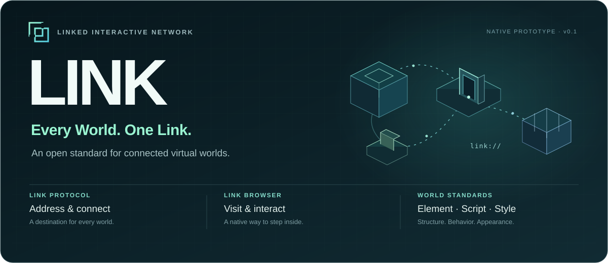
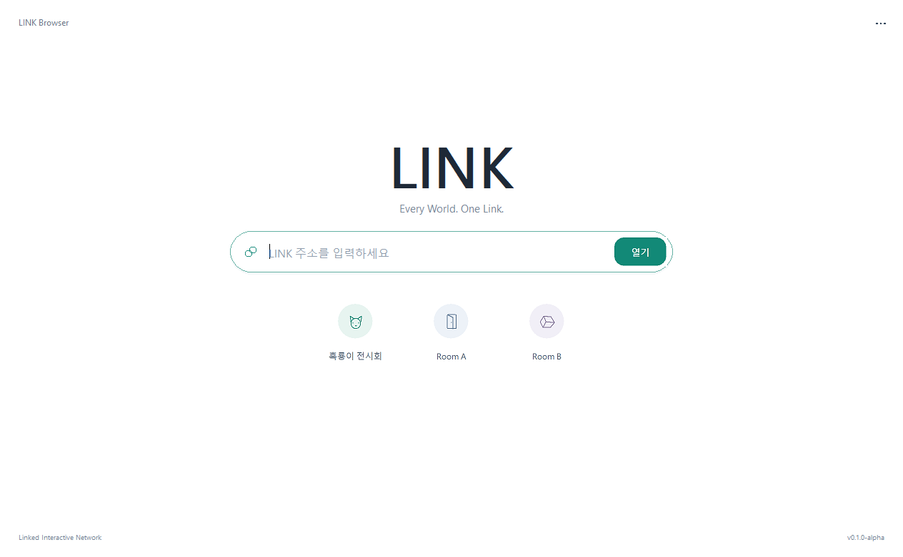

<p align="center">
  
</p>

<p align="center">
  <strong>English</strong> · <a href="README.ko.md">한국어</a>
</p>

# LINK

**Every World. One Link.**

Build a world. Give it an address. Let someone step inside.

**LINK — Linked Interactive Network** is a project for connecting virtual worlds through a common protocol, a native browser, and shared world standards. A creator describes a place: its structure, its behavior, its appearance. A visitor opens a `link://` address and enters it. A portal can lead to another world.

**Our vision: An open standard for connected virtual worlds.**

The direction is an ecosystem where creators can author worlds and people can move between them through one browser. The current implementation is an **experimental v0.1**, with a native C++20 browser on Windows, local worlds, and an initial **LAN HTTP transport**. Open a world from another computer with `link://192.168.0.10:8000/hello-world`, using that server's actual IPv4 address.

**[Create your first world →](docs/guides/README.md)** · [Element](docs/guides/element.md) · [Script](docs/guides/script.md) · [Style](docs/guides/style.md)

## One ecosystem, three foundations

| Foundation | Purpose | In this prototype |
| --- | --- | --- |
| **LINK Protocol** | Define world addresses, navigation, and browser ↔ world/server communication contracts. | Local `link://local/...` addresses, IPv4 LAN addresses, confined resources, and portal navigation. |
| **LINK Browser** | Visit, render, explore, and interact with worlds. | A Windows native app with 3D rendering, walking, interaction, reload, and world lifecycle management. |
| **World Standards** | Give creators a common way to describe worlds. | **Element** for structure, **Script** for behavior, **Style** for appearance, parsed and executed by the C++ runtime. |

These parts develop together. The protocol defines addresses and how world documents reach the browser. The standards describe what is there. The browser brings it to life. The [LAN v0.1 contract](docs/link-lan-v0.1.md) maps remote LINK addresses to HTTP resources while keeping the world format at v0.1.

## Create a world

A world is a small set of editable documents:

```text
first-world/
├── world.link           # Identity, entry camera, and document references
├── scene.element        # Objects, components, and visual elements
├── appearance.style     # Materials and appearance rules
└── scripts/
    └── pulse.script     # Behavior written in LINK Script
```

- **[Element](docs/guides/element.md)** composes Objects, Components, and Elements into a hierarchy. Parent transforms carry the parts together.
- **[Script](docs/guides/script.md)** adds local state, frame updates, and click behavior through a small API and lifecycle hooks.
- **[Style](docs/guides/style.md)** defines materials and class/ID rules. Change the document and reload to see the result.

The browser reads the world documents at runtime. Editing a world's structure, behavior, or appearance does not require recompiling the browser.

Start with the **[authoring guide](docs/guides/README.md)** and its **[runnable first-world example](docs/guides/examples/first-world/world.link)**. The full [language specification](native/docs/language.md) documents the grammar, APIs, validation, and budgets.

## Run LINK Browser

**Requirements:** Windows 10/11 x64, Visual Studio 2022 with **Desktop development with C++**, a Windows SDK, and CMake tools. The native implementation uses C++20, Win32, and WGL/OpenGL.

From the repository root, PowerShell can build and test using the helper, which also finds Visual Studio's CMake when it is outside `PATH`:

```powershell
powershell -NoProfile -ExecutionPolicy Bypass -File .\scripts\build-native.ps1 -Test
.\build\native\Release\LINK.exe
```

With CMake available in a developer terminal:

```powershell
cmake --preset windows
cmake --build --preset release --parallel
ctest --preset release
.\build\native\Release\LINK.exe
```

Once built, **[LINK_START.cmd](LINK_START.cmd)** opens the home screen. World files are copied beside the executable in `worlds/`. Keep that directory with the app when moving the build; another PC also needs a compatible MSVC runtime. Initial tool installation may need downloads. Bundled local worlds run offline; remote worlds download their documents, scripts, and images from the selected server.



Open the tutorial world directly from its source directory:

```powershell
.\build\native\Release\LINK.exe --worlds "$PWD\docs\guides\examples" --open link://local/first-world
```

Or choose the repository's demo worlds:

```powershell
.\build\native\Release\LINK.exe --worlds "$PWD\native\worlds" --open link://local/room-a
```

`--worlds` selects an explicit local root; relative document references resolve inside each world. See [LINK Protocol: local addresses](docs/link-local-v0.1.md). If the checkout moved, the build helper regenerates stale CMake paths; `-Fresh -Test` also requests a clean configuration.

## Open a world over LAN

The server is a separate sibling repository, `link-server`, using Python 3.10+ and its standard library. Update both the server and browser; older local-only browser builds cannot open remote addresses.

On the server PC, from `link-server`:

```powershell
.\LINK_SERVER_START.cmd
# Or choose an explicit world root:
python .\link_server.py --host 0.0.0.0 --port 8000 --worlds "C:\LINK\worlds"
```

Use the IPv4 address printed by the server for the active Ethernet or Wi-Fi adapter. `0.0.0.0` is a bind setting; `127.0.0.1` reaches only the same PC. On another PC on the same trusted network, enter the server address in LINK Browser or run this from the browser repository:

```powershell
.\build\native\Release\LINK.exe --open link://192.168.0.10:8000/hello-world
```

Replace `192.168.0.10` with the server's actual IPv4 address. Omitting the port uses `8000`. The server's `hello-world` and `second-world` examples include an image, a client-side Script, and portals that stay on the same server. **F5** fetches a fresh world; failed or cancelled loading keeps the current world.

This is plain HTTP for a trusted LAN. DNS, HTTPS, authentication, multiplayer state, and OS `link://` handler registration are future work. The server does not change Windows Firewall. See the [LAN contract and setup guide](docs/link-lan-v0.1.md) for resource limits, hosting existing worlds, and connection checks.

## Explore and interact

The home screen puts **LINK**, an address field, and shortcuts to **흑룡이 전시회**, **Room A**, and **Room B** at the center. Enter an address and press **Enter**, or choose a shortcut. Inside a world, a compact address bar leaves room for exploration.

**Ctrl+L** selects the address, **F5** reloads the world documents and resets runtime state, and **F12** toggles developer tools with the inspector and execution log. Developer tools start hidden. **Esc** cancels loading or closes a photograph.

| Context | Controls |
| --- | --- |
| Walking worlds | Click the viewport, then **WASD / arrow keys** to move and **mouse drag** to look around. |
| Observation worlds | **Left drag** to orbit, **right drag** to pan, **wheel** to zoom. |
| Interactive objects | Click an element to send interaction to its nearest owning script binding. |
| Photographs | **Double-click** to open a larger view; **← / →** changes photos and **Esc** closes it. |
| Portals | Walk into the portal's trigger to prepare and open its destination LINK address. |

## What works today

- A C++ lexer, document parsers, and an AST interpreter for LINK's own authoring languages.
- A renderer-independent object model with hierarchy, transforms, IDs, state, and instance-local script storage.
- Style resolution, primitive geometry, local or downloaded image resources, and native rendering.
- Walking and local or remote portals, bounded HTTP downloads, cancellable loading, fresh reload, validation errors, and cleanup when worlds change.
- Automated core, image, and path-confinement checks, plus native input smoke tests. Run the included checks with `ctest --preset release` after building.

This prototype targets **trusted local documents and trusted LAN servers**. Downloaded Script runs in each browser's world instance through the same constrained API. Input and interpreter budgets are implemented; process isolation and stronger permissions remain future work. The grammar and APIs are experimental and may change.

## Worlds to try

The included worlds exercise the same browser and runtime:

| World | Address | Try it |
| --- | --- | --- |
| Photo corridor — **흑룡이 전시회** | `link://local/heukryong` | Walk past photographs, double-click an image, and enter the portal at the end. |
| Hello World | `link://local/hello-world` | Step through the corridor portal onto a cosmic plaza. Walk toward monumental 3D letters and a vast ring beneath planets and stars. |
| Room A | `link://local/room-a` | Open a hinged door and watch a time-based rotating sculpture. |
| Room B | `link://local/room-b` | Test independent object state with two breakable stones. |

Photo originals are read-only inputs; the demo uses separate display copies. [Demo and asset notes](docs/exhibition.md) cover preparation. The gallery is one example of what a world can contain.

## Where LINK is heading

The long-term goal is a connected-world ecosystem with interoperable authoring and multiple implementations. Work ahead includes:

- Versioned world contracts and clearer interoperability requirements.
- DNS and server discovery, TLS transport, authentication, and interoperable protocol profiles.
- World permissions, stronger execution isolation, and shared state.
- Broader native platform support and, later, immersive input and rendering.

These are project directions beyond the current local and LAN prototype. An open standard is the vision; v0.1 is the starting point for testing its ideas in a working browser.

**Build a world. Explore the boundaries. Help shape how worlds connect.**

[Authoring guides](docs/guides/README.md) · [World Standards](docs/link-world-v0.1.md) · [Local protocol](docs/link-local-v0.1.md) · [LAN protocol](docs/link-lan-v0.1.md) · [Run LINK Browser](#run-link-browser)

## License

The source code, standards documents, authoring guides, examples, and non-photographic project assets are licensed under the **[Apache License 2.0](LICENSE)**.

Personal photograph originals in `image/**` and their display copies in `native/worlds/heukryong/assets/**` are **excluded from Apache 2.0** and covered by the separate [photo asset terms](ASSET_LICENSE.md). Those terms permit the photographs to accompany the included LINK demo for building, running, testing, and viewing it; they do not grant general permission to reuse the photographs.

Apache 2.0 does not grant general trademark permission for the LINK name or logo; Section 6 of [LICENSE](LICENSE) applies.
