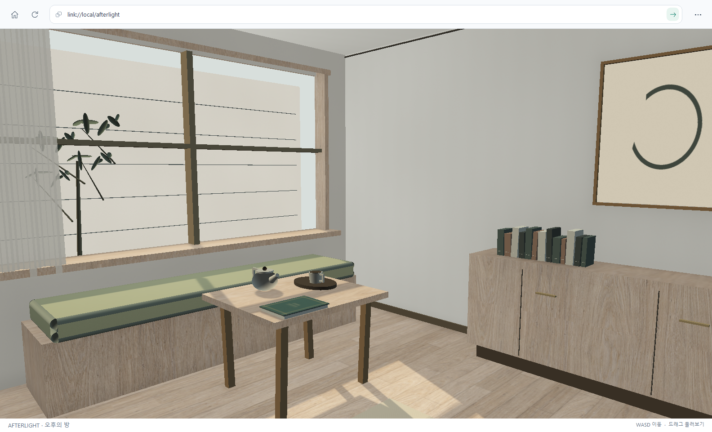
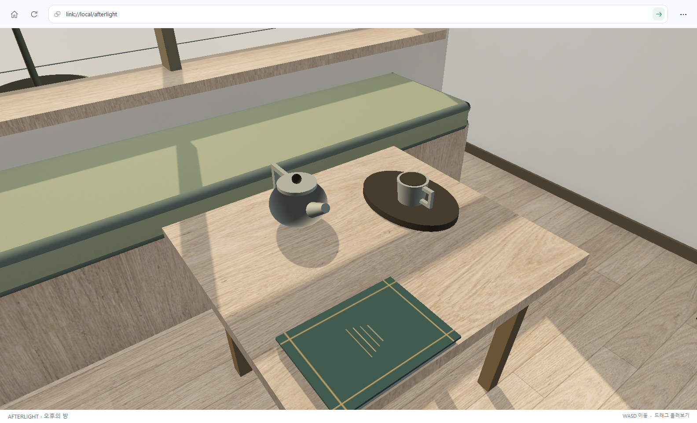

# AFTERLIGHT · 오후의 방

AFTERLIGHT는 창으로 들어오는 오후빛, 오크 가구, 리넨과 작은 생활 물건을 배치한 **5.4 × 4.6 × 2.95m**의 LINK 공간입니다. 방과 창밖 안뜰을 실제 3D 형상과 image plane으로 구성하고, 미리 계산한 낮빛·가림·접촉 그림자를 표면에 담았습니다. 가까이 걸어가 가구의 두께와 물건의 배치를 살펴보고 책과 조명을 조작할 수 있습니다.



## 열기와 조작

[빌드 안내](../README.ko.md#link-browser-실행)에 따라 최신 LINK Browser를 만든 뒤 주소창에서 `link://local/afterlight`를 엽니다. 소스 폴더를 직접 사용하려면 저장소 루트의 PowerShell에서 실행합니다.

```powershell
.\build\native\Release\LINK.exe --worlds "$PWD\native\worlds" --open link://local/afterlight
```

기본 `worlds` 루트는 실행 파일 옆입니다. `--worlds`는 공간 폴더들의 부모 디렉터리를 지정하므로 위 명령은 `native/worlds/afterlight/world.link`를 읽습니다. 이후 문서를 고치고 **F5**를 누르면 다시 읽으며 상호작용 상태도 초기화됩니다.

- 화면을 클릭한 뒤 **WASD/방향키**로 이동하고 **마우스 드래그**로 둘러봅니다. 눈높이는 1.62m, 이동 속도는 초당 1.35m입니다.
- 낮은 탁자의 **책 표지**를 클릭하면 책등을 축으로 135° 열립니다. 다시 클릭하면 닫힙니다.
- **스탠드 받침**을 클릭하면 전구의 밝기와 벽의 작은 빛무리가 함께 켜지고 다시 클릭하면 꺼집니다.
- 창가 커튼은 최대 6mm 범위에서 천천히 움직입니다.
- **Ctrl+L**로 주소를 선택하고 **F12**로 검사기와 실행 로그를 엽니다.

걷기는 `world.link`의 직사각 이동 범위 안에서 눈높이를 고정합니다. 일반 형상 충돌이나 중력 계산은 포함하지 않습니다. 벽과 가구의 표면 이미지는 사진 확대 목록에서 제외되며, 책과 조명의 클릭은 일반 Script 바인딩으로 전달됩니다.

## 화면을 만드는 방식

[scene.element](../native/worlds/afterlight/scene.element)는 벽·바닥·천장, 창틀, 가구와 물건의 배치를 정의합니다. 표면의 색과 명암을 담은 image plane도 공간 안의 실제 위치와 방향을 가지므로 이동할 때 원근과 가림이 바뀝니다. 방 전체를 촬영한 배경 이미지로 대신하지 않습니다. [appearance.style](../native/worlds/afterlight/appearance.style)는 기본 형상의 재질과 전구의 외형을 정하며, 세 [Script](../native/worlds/afterlight/scripts/)가 책·조명·커튼의 동작을 담당합니다.

낮빛과 주변 가림(AO), 접촉 그림자는 **제작 시 미리 계산한 정적 베이크**입니다. 현재 브라우저는 실시간 전역 조명(GI), 경로 추적, 실시간 반사를 수행하지 않습니다. 책이 움직여도 표면에 저장된 그림자를 다시 계산하지 않습니다. 스탠드를 켤 때에는 전구의 `emission`과 미리 만든 작은 벽 빛무리를 전환하며, 방 전체의 빛을 다시 계산하지 않습니다.

네이티브 브라우저는 장면 이미지의 원래 비율을 유지하며 긴 변 최대 2,048px까지 준비합니다. 모든 밉 레벨과 텍스트를 합친 장면 예산이 150MiB에 들어오도록 가장 큰 이미지 할당부터 줄이므로, 이미지 수와 크기에 따라 실제 준비 해상도는 낮아질 수 있습니다. 트라이리니어 필터와 알파를 고려한 밉맵을 사용하며, 사진 확대 보기를 포함한 전체 업로드에는 별도의 256MiB 상한을 적용합니다.



## 자산 출처와 재생성

형상, 배치, 절차적 표면과 베이크는 프로젝트의 [generate_afterlight.py](../scripts/generate_afterlight.py)에서 제작합니다. 오크의 기본색 소스 [afterlight-oak.png](../scripts/materials/afterlight-oak.png)만 내장 `imagegen` 도구로 생성했으며, 생성기는 이 재료 이미지를 오크 표면의 색으로 사용합니다. 그 밖의 표면, 책 인쇄, 액자 속 드로잉과 벽 빛무리는 프로젝트에서 절차적으로 생성합니다. 사진으로 촬영한 방 배경이나 외부 방 모델은 사용하지 않습니다.

실행에 필요한 문서와 PNG는 `native/worlds/afterlight/`에 포함되어 있습니다. 공간을 방문하기 위해 Python이나 생성기를 설치할 필요는 없습니다. 제작 자산을 다시 만들 때에만 **Python 3.10 이상과 NumPy**가 필요합니다.

```powershell
python -m pip install numpy
python .\scripts\generate_afterlight.py
```

기본 실행은 `native/worlds/afterlight/`의 장면·Style·Script·이미지와 `bake-info.json`을 다시 씁니다. 반복할 배치·재질 변경은 생성기에 반영합니다. 다른 출력 폴더를 사용하려면 `--output`을 지정합니다.

```powershell
python .\scripts\generate_afterlight.py --output .\scratch\afterlight
```

[bake-info.json](../native/worlds/afterlight/bake-info.json)은 현재 생성 결과의 노드 수, 이미지 수와 각 이미지 크기를 기록합니다. 이 파일은 제작 기록이며 브라우저의 진입 문서는 [world.link](../native/worlds/afterlight/world.link)입니다. 기본 LINK 문법과 이미지 제한은 [제작 언어 명세](../native/docs/language.md#이미지와-제목-표지)를 따릅니다.

## 다른 PC에서 열기

별도 `link-server`의 공간 루트에 `afterlight` 폴더 전체가 있어야 합니다. 서버가 `native/worlds`를 공간 루트로 사용하면 이 저장소의 문서와 자산을 그대로 제공할 수 있습니다. 예를 들어 두 저장소가 형제 폴더라면 서버 저장소에서 실행합니다.

```powershell
python .\link_server.py --host 0.0.0.0 --port 8000 --worlds "..\link\native\worlds"
```

같은 신뢰하는 LAN의 다른 PC에서 최신 브라우저로 `link://SERVER_IP:PORT/afterlight`를 엽니다. `SERVER_IP`와 `PORT`를 서버가 표시한 실제 IPv4와 포트로 바꿉니다. 브라우저가 문서·Script·이미지를 가져오며 **F5**로 다시 가져옵니다. 전체 설정과 전송 제한은 [LAN 안내](link-lan-v0.1.md)를 따릅니다.

오크 기본색은 built-in imagegen으로 생성했습니다. 재현을 위한 전체 [원목 생성 프롬프트](../scripts/materials/afterlight-oak.prompt.txt)를 함께 보관합니다.
