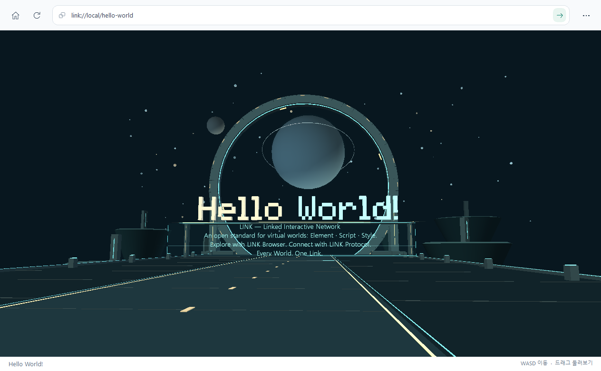

# 사진 공간

흑룡이 사진 27장을 긴 복도 양쪽 벽에, 본인 사진 1장을 입구에 배치한 LINK Browser의 네이티브 3D 공간입니다. 홈에서는 **흑룡이 전시회**로 열며 공간 문서의 이름은 **사진 공간**, 주소는 `link://local/heukryong`입니다. 사진과 액자를 두고 제목·헌정·장식 문구는 표시하지 않습니다. 복도 끝 포탈의 `/hello-world`로 걸어 들어가면 입체 **Hello World!** 형상을 볼 수 있습니다. 기본 로컬 실행에서는 `link://local/hello-world`로 이동하며, 두 공간을 서버에서 호스팅하면 같은 서버의 IPv4와 포트를 유지합니다.

## 열기와 조작

[README의 빌드 안내](../README.ko.md#link-browser-실행)에 따라 실행 파일을 만든 뒤 엽니다.

빌드한 뒤 루트의 `LINK_START.cmd`로 LINK Browser 홈을 열고 **흑룡이 전시회**를 누릅니다. 홈 중앙에는 LINK와 주소 입력창, 흑룡이 전시회·Room A·Room B 바로가기가 있습니다. Hello World는 복도 끝 포탈로 이어집니다.

기본 `worlds` 루트는 실행 파일 옆입니다. 소스 문서를 편집한 내용을 바로 reload하려면 `--worlds "$PWD\native\worlds"`를 지정합니다. 기본 형상·외형·시점의 수정은 C++ 재컴파일 없이 **F5/새로 고침**으로 읽습니다.

- 화면을 클릭해 입력을 둔 뒤 W/S 또는 ↑/↓로 앞뒤로 걷고 A/D 또는 ←/→로 좌우로 이동합니다. 마우스를 드래그하면 시선을 돌립니다.
- 사진을 더블클릭하면 큰 사진 보기가 열립니다. **←/→** 또는 이전/다음 사진 버튼으로 넘기고 **Esc/닫기**로 사진 공간에 돌아옵니다.
- 큰 사진을 닫은 뒤 복도를 계속 걸을 수 있습니다. 확대 보기 동안 방향키는 사진 넘기기에 사용합니다.
- 홈으로 돌아가거나 다른 주소를 열면 큰 사진 보기가 닫힙니다. 로딩 중 **Esc**는 준비 요청을 취소합니다.
- **Ctrl+L**로 상단 주소를 선택합니다. 검사기와 실행 로그는 기본으로 숨겨져 있으며 **F12**로 개발자 도구를 열고 닫습니다.

큰 사진은 원래 가로세로 비율을 유지합니다. 공간에 배치한 사진 텍스처는 긴 변 512 px까지, 선택한 큰 사진은 2,048 px까지 준비합니다. 포함된 JPEG 파생본의 긴 변은 최대 1,280 px이므로 현재 큰 사진의 유효 해상도도 그 범위입니다.

## 구성

[제작 문서](../native/worlds/heukryong/scene.element)와 [인벤토리](../native/worlds/heukryong/inventory.json)의 구성은 다음과 같습니다.

| 구분 | 수량 | 파생 자산 |
| --- | ---: | --- |
| 흑룡이 사진 | 27장 | `assets/cat-001.jpg` … `cat-027.jpg` |
| 본인 사진 | 1장 | `assets/owner-001.jpg` |
| 전체 사진·액자 | 각각 28개 | 각 사진이 image plane과 frame Element로 한 번씩 배치됨 |
| 복도 배치 | 양쪽 14개 대면 구간 | 고양이 사진 왼쪽 14장·오른쪽 13장, 본인 사진은 입구 왼쪽 |

사진은 원본 폴더별 파일 이름의 마지막 숫자를 자연수 순서로 정렬해 인벤토리에 기록합니다. 따라서 `흑룡이1.jpg`, `흑룡이2.jpg`, …, `흑룡이27.jpg` 순서이며 숫자가 없는 이름은 파일 이름으로 정렬합니다. 고양이 사진은 양쪽 벽의 눈높이 약 1.72m에 놓고 각 사진의 비율을 유지합니다. 본인 사진은 복도에 들어서며 볼 수 있는 입구 왼쪽에 둡니다. 사진·액자·복도 형상은 일반 Object·Component·Element로 선언하며 부모 변환을 따릅니다. 배경·격자는 `environment`, 관찰 위치 메타데이터는 `views`, 이동 범위·속도는 `walk`, 포탈은 `portals` 문서 필드로 지정합니다. `views`는 내부 검증에 쓰며 사용자 화면에는 시점 선택·이전/다음 시점 버튼을 표시하지 않습니다.

## 원본과 파생본

앱에서 사용할 고양이 사진은 저장소의 `image/흑룡이/흑룡이1.jpg`부터 `흑룡이27.jpg`까지, 본인 사진은 `image/songyoungwoon/songyoungwoon.jpg`에서 읽습니다. 준비 스크립트는 **원본 경로에 저장하지 않습니다**. 표시용 파일은 `native/worlds/heukryong/assets/`에 별도로 만듭니다. EXIF 방향을 반영하고 비율을 유지해 긴 변 최대 1,280 px로 축소하며 작은 이미지는 늘리지 않습니다. 기본 JPEG 품질은 90입니다. `image/` 아래 원본은 모두 보존하며 선택하지 않은 이미지는 앱 사본·인벤토리·장면에 포함하지 않습니다.

`inventory.json`에는 각 사진의 원본 상대 경로·SHA-256, 파생 자산 경로, 원래 크기·회전 반영 후 크기·파생 크기와 EXIF 방향을 기록합니다. 인벤토리는 자산 출처를 추적하는 자료이며 LINK Browser가 실행할 장면 문서는 `world.link`·`scene.element`·`appearance.style`입니다. 원본 폴더를 공간 리소스 경로로 직접 연결하지 않습니다.

표시용 파생 파일이 포함되어 있으므로 사진을 보기 위해 다시 생성할 필요는 없습니다. 재생성하려면 Windows PowerShell과 Python 3을 사용합니다.

```powershell
# 원본을 읽어 파생 JPEG·인벤토리를 만든 다음 두 공간의 문서를 생성
powershell -NoProfile -ExecutionPolicy Bypass -File .\scripts\prepare-exhibition.ps1

# 파생 이미지 준비만 수행
powershell -NoProfile -ExecutionPolicy Bypass -File .\scripts\prepare-exhibition.ps1 -SkipGeneration

# 기존 인벤토리로 배치·외형·진입 문서만 다시 생성
python .\scripts\generate_exhibition.py
```

`prepare-exhibition.ps1`의 `-LongEdge`·`-Quality`로 파생 설정을 조정할 수 있습니다. 현재 원본 구성은 흑룡이 27장·본인 1장이며 생성기는 인벤토리의 사진 수에 따라 액자 배치와 복도 길이를 계산합니다. 원본 구성이 달라지면 준비 스크립트를 다시 실행해 파생 파일·인벤토리·공간 문서를 함께 갱신합니다. 생성할 때 `scene.element`, `appearance.style`, `world.link`를 덮어쓰므로 반복 가능한 배치·색상 변경은 [생성기](../scripts/generate_exhibition.py)에 반영합니다. 원본 사진 폴더는 읽기 입력으로 유지합니다.

## 걷기와 포탈

걷기는 시선의 수평 방향을 기준으로 움직이고 대각선 이동 속도를 보정합니다. 눈높이는 문서의 값으로 고정하며 XZ 이동은 선언한 직사각 범위 안으로 제한합니다. 일반 형상 충돌·중력·계단을 계산하는 물리 엔진은 아닙니다. 현재 사진 복도의 걷기 속도는 초당 3.4m입니다.

포탈의 눈 위치 감지 상자 안으로 걸어 들어가면 대상 LINK의 파일을 준비하고 검증한 뒤 공간을 교체합니다. 이동 경로와 상자를 함께 검사해 한 프레임에 얇은 포탈을 통과해도 감지합니다. 이미 상자 안에서 시작한 움직임은 같은 포탈의 재진입으로 처리하지 않습니다. 대상 준비 실패는 현재 공간을 유지하며 로딩 취소·홈·주소 입력으로 다시 조작할 수 있습니다. 포탈의 `/hello-world`는 현재 LINK authority를 유지합니다. 로컬에서는 대상 파일을 읽으며, [LAN HTTP](link-lan-v0.1.md)로 열었다면 같은 서버에서 대상 문서·Script·이미지를 가져옵니다. 명시적 `link://local/...`만 방문자의 로컬 루트를 가리킵니다.

## Hello World!

복도 끝 포탈을 넘어가면 별과 행성, 부유섬 사이에 펼쳐진 우주 광장에 도착합니다. 긴 진입로 너머로 거대한 고리와 **Hello World!**가 기다립니다. 첫 세계를 지나 더 넓은 곳으로 걸어 나가는 순간을 담은 공간입니다.



[Hello World 제작 문서](../native/worlds/hello-world/scene.element)는 길이 86m의 광장, 직경 34m의 고리, 폭 약 30m의 입체 인사말과 주변 천체를 Element 형상으로 구성합니다. **Hello World!**의 깊이는 .74m이며, box 획을 조합한 실제 3D 형상입니다. 이 인사말은 글자 이미지를 붙인 평면이나 글꼴 텍스처를 사용하지 않습니다. Style의 `emission`은 조명과 별·표식의 밝기를 표현하고, `environment.fog`는 먼 풍경의 깊이감을 만듭니다. [Script](../native/worlds/hello-world/scripts/horizon.script)는 고리의 표식을 천천히 회전시킵니다.

인사말 아래에는 **LINK · Linked Interactive Network**, **Element · Script · Style**, **LINK Browser**, **LINK Protocol**을 영어로 소개하는 청록색 홀로그램이 떠 있습니다. 소개 문구는 `textBackground:false`인 투명 배경 text plane이며, 얇은 반투명 패널과 유도 조명을 함께 배치합니다. [홀로그램 Script](../native/worlds/hello-world/scripts/hologram.script)가 패널을 조금씩 띄우고 스캔선을 천천히 움직입니다. 가까이 걸어가 내용을 읽을 수 있습니다.

도착한 뒤에도 **WASD/방향키**로 계속 걷고 **마우스 드래그**로 둘러봅니다. 이동 속도는 초당 5.1m이며, 눈높이를 고정한 채 광장의 선언된 범위 안을 탐험합니다. 앞으로 걸어가 입체 글자의 크기와 두께를 느끼거나 주변을 돌아보며 행성과 부유섬을 살펴보세요. 기본 로컬 주소는 `link://local/hello-world`이며 원격으로 열면 서버의 authority를 유지합니다.

기존 자체 Script 예제는 `link://local/room-a`와 `link://local/room-b`에서 그대로 사용할 수 있으며 걷기 대신 기존 관찰 카메라를 유지합니다. 현재 구성의 자동 검사는 저장소 루트에서 빌드 후 `ctest --preset release`로 실행합니다. 위 수량은 현재 사진 구성 정보입니다.
