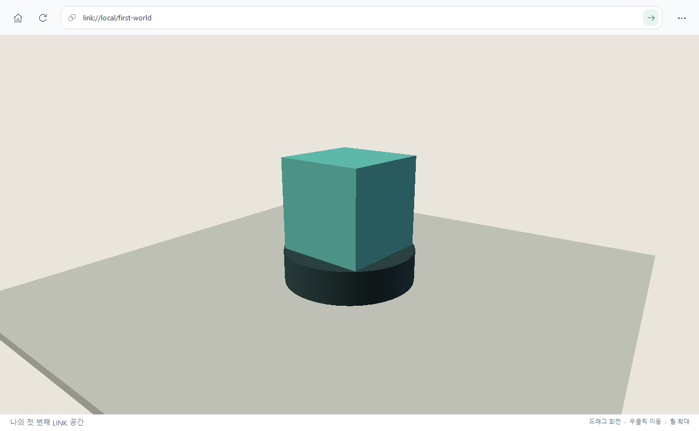

# LINK 공간 제작 가이드

Element로 공간을 만들고, Style로 외형을 정하고, Script로 움직임과 반응을 붙입니다. 이 가이드를 따라가면 **회전하는 큐브를 클릭해 색을 바꾸는 공간**을 직접 실행할 수 있습니다.

이 문서는 현재 LINK Browser가 읽는 **LINK World Standards v0.1**을 설명합니다. 실험 중인 제작 문법이며, 실제 C++ 로더와 인터프리터에서 지원하는 기능만 사용합니다. LINK는 프로젝트 이름, LINK Protocol은 공간 주소·탐색 계약, LINK Browser는 문서를 읽어 실행하는 앱입니다.

## 먼저 예제 실행하기

PowerShell에서 프로젝트 루트를 현재 폴더로 엽니다. 아직 실행 파일을 만들지 않았다면 Windows의 Visual Studio 2022 C++ 빌드 도구와 CMake가 필요합니다.

```powershell
# 처음 빌드할 때
powershell -NoProfile -ExecutionPolicy Bypass -File .\scripts\build-native.ps1 -Test

# 문서에 포함된 공간을 별도의 로컬 공간 목록으로 열기
& .\build\native\Release\LINK.exe --worlds "$PWD\docs\guides\examples" --open link://local/first-world
```

`--worlds`에는 **공간 폴더들의 부모 디렉터리**를 지정합니다. 이 명령은 `examples/first-world/world.link`를 읽습니다. 예제는 이미지 다운로드나 별도 라이브러리 없이 실행되며, 앱에 기본 제공되는 공간 목록을 변경하지 않습니다. 이 창의 주소 기준은 지정한 `examples`이므로 기본 제공 Room A/B를 열려면 기본 옵션으로 앱을 다시 실행합니다.

중앙의 민트색 큐브가 회전하면 준비가 끝났습니다.



1. 큐브를 한 번 클릭하면 따뜻한 주황색으로 바뀝니다.
2. 다시 클릭하면 Style 문서에서 계산한 민트색으로 돌아갑니다.
3. 마우스를 왼쪽 버튼으로 드래그하면 회전해서 관찰하고, 오른쪽 드래그로 화면을 이동하며, 휠로 거리를 조절합니다.
4. 문서의 값을 고친 뒤 앱의 **새로 고침**을 누르면 새 파일로 공간을 다시 만듭니다. 클릭 횟수와 회전 각도도 초기화됩니다.

## 네 파일의 역할

```text
examples/
└─ first-world/
   ├─ world.link
   ├─ scene.element
   ├─ appearance.style
   └─ scripts/
      └─ pulse.script
```

| 파일 | 작성하는 내용 | 이번 예제 |
| --- | --- | --- |
| [world.link](examples/first-world/world.link) | 공간 이름, 문서 경로, 시작 카메라 | 세 문서를 연결하는 진입 문서 |
| [scene.element](examples/first-world/scene.element) | Object·Component·Element 구조와 형상 | 바닥, 받침대, 회전 부품, 큐브 |
| [appearance.style](examples/first-world/appearance.style) | 재질과 선택자 규칙 | 민트색 큐브와 재질 우선순위 |
| [pulse.script](examples/first-world/scripts/pulse.script) | 생명주기별 동작 | 일정 속도 회전, 클릭 색상 전환 |

앱은 `world.link`를 먼저 읽고 참조된 문서를 검증합니다. `scene.element` 안 Object·Component의 `script`는 매니페스트의 `scripts` 목록에 **같은 문자열**로 등록되어 있어야 합니다. 예를 들어 `"scripts/pulse.script"`와 `"./scripts/pulse.script"`는 바인딩 문자열이 다릅니다. 예제처럼 같은 표기를 쓰면 혼동을 피할 수 있습니다.

## 권장 읽기 순서

| 순서 | 문서 | 만들어 볼 것 |
| --- | --- | --- |
| 1 | [Element — 구조와 배치](element.md) | 큐브 크기와 위치를 바꾸고 새 형상 추가 |
| 2 | [Style — 재질과 선택자](style.md) | 기본색과 클릭 전 외형 변경 |
| 3 | [Script — 움직임과 상호작용](script.md) | 회전 속도와 클릭 반응 변경 |

각 가이드의 전체 코드와 `examples/first-world`의 실제 파일은 같은 예제입니다. 필요한 파일을 직접 열어 수정해도 됩니다. 문법 전체의 기준은 [제작 언어 명세](../../native/docs/language.md), 주소·경로 기준은 [로컬 LINK Protocol 명세](../link-local-v0.1.md)와 [LAN HTTP 계약](../link-lan-v0.1.md)에서 확인합니다.

작은 실내를 구성하는 응용 예제는 [AFTERLIGHT · 오후의 방](../afterlight.md)에서 살펴볼 수 있습니다. 실제 3D 형상과 정적 표면 베이크를 함께 사용하며 책·조명·커튼에 일반 Script 동작을 붙입니다.

## 나만의 공간으로 복사하기

프로젝트 루트에서 아직 없는 `my-world` 폴더로 복사합니다.

```powershell
Copy-Item -LiteralPath .\docs\guides\examples\first-world -Destination .\docs\guides\examples\my-world -Recurse
```

새 폴더의 `world.link`에서 `id`를 `"my-world"`, `name`을 원하는 이름으로 바꾼 뒤 실행합니다.

```powershell
& .\build\native\Release\LINK.exe --worlds "$PWD\docs\guides\examples" --open link://local/my-world
```

LINK 주소 끝의 `my-world`는 폴더 이름입니다. 로컬·LAN 주소의 공간 폴더 이름은 영문자·숫자·하이픈을 사용합니다. Element 내부 ID에는 다른 규칙이 적용되어 `sample_cube`처럼 영문자 또는 `_`로 시작하는 식별자를 사용합니다.

## LAN에서 내 공간 열기

제작 문법은 그대로 두고 공간 폴더의 부모 디렉터리를 별도 `link-server`로 공개할 수 있습니다. 서버 PC의 `link-server` 폴더에서 Python 3.10 이상으로 실행합니다. 아래는 브라우저 저장소와 서버 저장소를 형제로 둔 예입니다.

```powershell
python .\link_server.py --host 0.0.0.0 --port 8000 --worlds "..\link\docs\guides\examples"
```

다른 PC의 최신 LINK Browser에서 `link://192.168.0.10:8000/my-world`를 엽니다. 예시 IP는 서버가 출력한 실제 Ethernet·Wi-Fi IPv4로 바꾸세요. 브라우저가 문서·Script·이미지를 가져오며 **F5**로 다시 가져옵니다. 서버와 브라우저를 모두 갱신해야 합니다. 기본 서버 예제는 `LINK_SERVER_START.cmd`로 열 수 있고, 전체 설정·방화벽 확인·전송 제한은 [LAN 안내](../link-lan-v0.1.md#run-the-server-and-browser-on-windows)를 따릅니다.

포탈의 `address: "/other-world"`는 현재 서버와 포트를 유지합니다. 로컬에서 같은 문서를 열면 `link://local/other-world`입니다. 명시적 `link://local/...`은 원격 공간에서도 방문자의 로컬 공간을 가리킵니다. 원격 대상은 선언할 때 문법만 확인하며 실제 진입 때 가져옵니다. Script는 방문자마다 따로 실행하고 상태를 공유하지 않습니다. 신뢰하는 LAN 서버와 문서에 사용하세요.

## 작성할 때 지킬 공통 규칙

파일은 **BOM 없는 UTF-8**로 저장합니다. 한글 이름과 문자열을 직접 쓸 수 있습니다. 필드는 `이름: 값;` 형식이고, 배열·맵 내부는 쉼표로 구분합니다.

```text
position: [0, 1.55, 0];
config: {speed: 45, visual: "sample_cube"};
```

문자열에는 큰따옴표를 씁니다. `true`·`false`·`null`은 따옴표 없이 쓰며 숫자는 유한수여야 합니다. `//` 한 줄 주석을 사용할 수 있습니다. 맵의 중복 키, 필드 중복, 후행 쉼표, 작은따옴표 문자열, 블록 주석은 허용하지 않습니다. 지원하지 않는 필드를 적으면 조용히 무시하지 않고 오류로 알려줍니다.

이미지 등 추가 파일은 자기 공간 폴더 안에 넣고 `assets/photo.jpg`처럼 상대 경로로 참조합니다. `/`를 경로 구분자로 사용하면 문자열의 역슬래시 escape를 피할 수 있습니다. `..`, 절대 경로, 공간 밖으로 이어지는 링크 참조는 사용할 수 없습니다.

## 오류를 읽고 고치기

오류의 기본 형태는 `파일:행:열: 설명`입니다. Script 실행 오류에는 노드 ID와 훅 이름도 표시됩니다. **F12**로 개발자 도구를 열고 실행 로그에 적힌 첫 오류 위치부터 확인합니다.

| 메시지 일부 | 먼저 확인할 것 |
| --- | --- |
| `expected ';'` | 선언 필드나 Script 문장 끝의 세미콜론 |
| `unsupported field` | 해당 문서·노드 종류에서 지원하는 필드인지 |
| `Script binding ... is not listed` | `script`와 매니페스트 `scripts`의 문자열 일치 |
| `unknown material` | `style` 이름과 `material` 선언 이름 일치 |
| `missing or inaccessible path` | `--worlds`가 부모 디렉터리인지, 참조 파일이 있는지 |
| `Node not found in current world` | config에 넣은 노드 ID가 실제로 선언되어 있는지 |
| `expected bool` / `expected number` | 조건·계산에 사용하는 값의 타입 |

먼저 파일을 저장하고 새로 고침합니다. 준비 단계에서 잘못된 문서를 발견하면 후보 공간을 열지 않고 오류를 표시합니다. Script 실행 도중 오류가 나면 해당 바인딩이 중지되므로 고친 뒤 새로 고침하여 새 인스턴스로 실행합니다.

문서 예제는 `link_core_tests`의 `documentation example` 항목에서 실제 파일을 읽어 검증합니다. 로드, 회전 시간, 클릭 전달, 색상 복원, 새 인스턴스 초기화, 종료 훅과 자원 해제를 함께 검사합니다.
